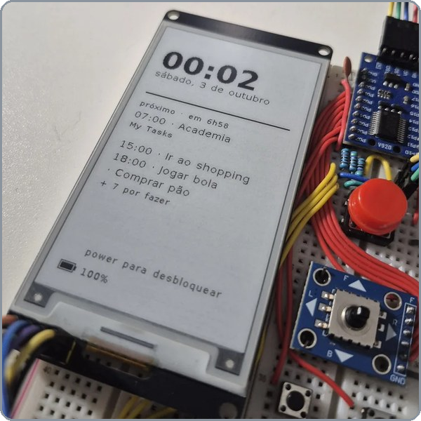
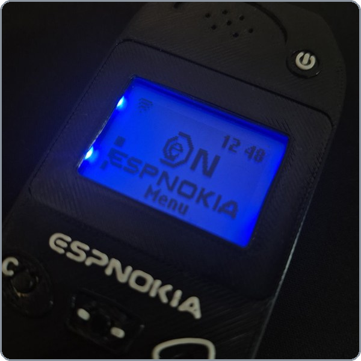

<h2 align="center">Bernardo Melo</h2>

  

  <b>Computer Engineer · embedded systems and backend</b> 
  C/C++ firmware for Espressif MCUs (ESP32, ESP32-S3), Python/FastAPI servers and the glue between them, with automated tests and CI.

  

---

### Main projects

<table>
  <tr>
    <td width="50%" valign="top">
      
      <h3><a href="https://github.com/Bernardik226/Tinto">Tinto</a></h3>
      

      
Pocket planner with an e-ink display. Hold the button, speak, and it becomes a Google Calendar event.

      <ul>
        <li>C firmware on the ESP32-S3 (ESP-IDF 5.3), plus a simulator that runs the UI on a PC, no board needed</li>
        <li>FastAPI server: Whisper transcription, parsing with the Claude API, Google Calendar and Tasks integration</li>
        <li>Setup PWA</li>
        <li>724 firmware tests, 282 server tests, GitHub Actions</li>
      </ul>
      
Firmware compiled to WebAssembly, runs in the browser: <a href="https://bernardik226.github.io/Tinto/"><b>try the demo</b></a>

       
      

    </td>
    <td width="50%" valign="top">
      
      <h3><a href="https://github.com/Bernardik226/espnokia-phone">espnokia-phone</a></h3>
      

      
A Nokia 3310 that talks to Claude.

      <ul>
        <li>C++17 firmware on the ESP32 (PlatformIO), apps and games on an 84×48 screen</li>
        <li>Case modeled and 3D printed</li>
        <li>FastAPI server with voice (Whisper) and Claude, in Docker, with a web dashboard</li>
        <li>120 native tests, 182 server tests, GitHub Actions</li>
      </ul>
       
      

    </td>
  </tr>
</table>

### Stack

  

### GitHub stats

  
  

